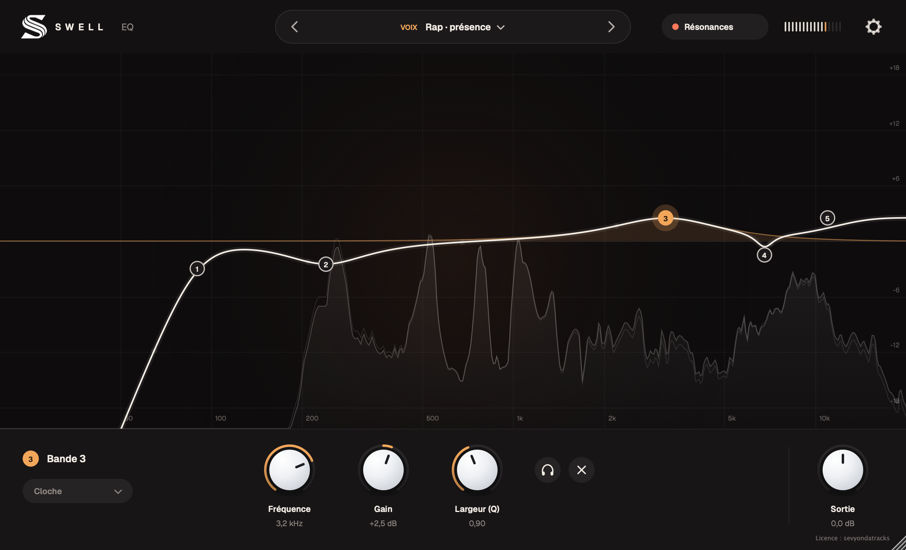

# Swell EQ 1.0.0

Égaliseur paramétrique 8 bandes, simple à prendre en main : on voit le son en temps réel, on clique sur la courbe,
et Swell EQ repère les résonances pour aider à les corriger.



Fabricant : Swell Audio. JUCE 8 (copie partagée `../Swell-Reverse/JUCE`). Formats : VST3, AU (Mac) et Standalone.

## Utilisation

- **Double-clic** sur la courbe : ajoute une bande à cet endroit (coupe-bas sous 35 Hz, coupe-haut au-dessus de 15 kHz,
  cloche ailleurs). Double-clic sur un point : le supprime.
- **Glisser** un point : fréquence et gain. **Molette** (ou deux doigts sur le trackpad) et **pincement** : largeur (Q). **Maj** : réglage fin. Clic droit : type, pente,
  solo, supprimer.
- Rangée du bas : réglages de la bande choisie (type, pente, fréquence, gain, Q, écoute en solo, suppression) et **Sortie**.
- Types : cloche, plateau grave, plateau aigu, coupe-bas, coupe-haut (12 / 24 / 36 / 48 dB/oct, Q réglable), coupe-bande.
- **Analyseur** en temps réel : spectre après l'égaliseur (rempli) et avant (trait fin), pente d'affichage +3 dB/oct.
  Roue dentée : analyseur avant + après / après seulement / désactivé, échelle ±6 / ±12 / ±18 dB (gain des bandes : ±18 dB), tout remettre à plat.
- **Résonances** : écoute le son quelques secondes (moyenne longue), repère les pics étroits qui dépassent nettement
  le spectre voisin, et les marque d'un point orange. Un clic sur un point ajoute une cloche qui l'atténue (gain et Q
  calculés d'après le pic) ; « Atténuer les N résonances » corrige tout d'un coup.

## Presets

31 presets d'usine (Voix, Kick, 808 & basse, Batterie, Instruments, Bus, Master, Correction), aussi visibles comme
« programmes » dans l'hôte. Chacun a une phrase qui dit à quoi il sert (affichée quand aucune bande n'est choisie).
Presets perso (`.swellpreset`) dans `Documents/Swell Audio/Swell EQ Presets`.

## Moteur

Filtres en variables d'état trapézoïdaux (topologie d'Andrew Simper) : latence nulle, stables même modulés à chaque
échantillon. Fréquence, gain et Q lissés sur 20 ms ; type, pente, marche/arrêt, solo et bypass passent par un fondu
de 15 ms : aucun clic. Coupe-bas / coupe-haut = Butterworth en cascade, le Q règle la résonance de la cellule la plus
pointue. La courbe affichée est la réponse exacte du filtre numérique. À plat, la sortie est identique à l'entrée au bit près.

## Licence Swell

Module commun `Source/Licence` (copie identique à celle des autres plugins Swell). Slug boutique : **`swell-eq`**
(`Source/LicenceConfig.h`) : le produit doit exister sous ce slug sur swell-audio.fr. Sans licence : silence et écran d'activation.

## Compiler et tester

```bash
cmake -S . -B build -DCMAKE_BUILD_TYPE=Release -DEQ_TESTS=ON
cmake --build build -j
build/EQCheck docs ../Vocal-Match-Tests/VOX.wav
```

`EQCheck` vérifie le silence sans licence, la réponse en fréquence mesurée au sinus (valeurs théoriques et courbe
affichée), l'absence de clics sur 11 manipulations, la latence nulle, les presets, l'état, la détection des résonances,
et écrit des captures PNG de l'interface.

Licence JUCE : JUCE est sous AGPLv3 ou licence commerciale ; vendre ce plugin en code fermé demande une licence JUCE commerciale.
Nom et interface propres à Swell : aucune marque, aucun visuel d'un autre fabricant.
